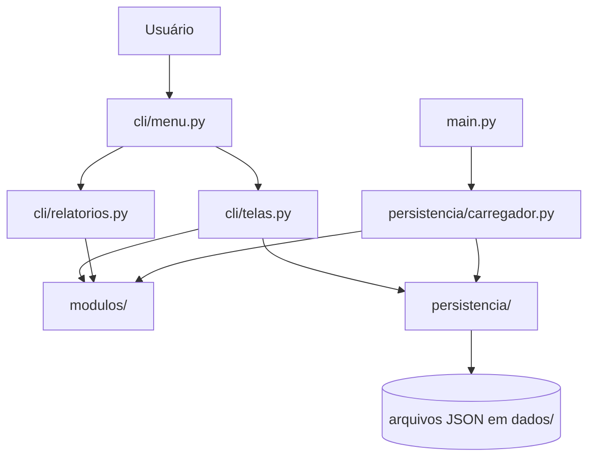

# Gerenciador de Cursos e Alunos

Sistema acadêmico desenvolvido em Python com interface de linha de comando (CLI), Programação Orientada a Objetos e persistência em arquivos JSON. A aplicação organiza cursos, alunos, turmas e matrículas, aplica regras de matrícula e disponibiliza relatórios acadêmicos.

## Sumário

- [Funcionalidades](#funcionalidades)
- [Regras de negócio](#regras-de-negócio)
- [Relatórios](#relatórios)
- [Arquitetura e decisões de design](#arquitetura-e-decisões-de-design)
- [UML](#uml)
- [Estrutura do projeto](#estrutura-do-projeto)
- [Configuração e execução](#configuração-e-execução)
- [Persistência e dados de demonstração](#persistência-e-dados-de-demonstração)
- [Testes](#testes)
- [Limitações conhecidas](#limitações-conhecidas)

## Funcionalidades

### Cursos

- Cadastrar, consultar, editar e remover cursos.
- Definir código, nome, carga horária e pré-requisitos.
- Adicionar e remover pré-requisitos.
- Validar referências e impedir ciclos entre pré-requisitos.

### Alunos

- Cadastrar, consultar, editar e remover alunos.
- Manter matrícula, nome e e-mail.
- Consultar histórico acadêmico e Coeficiente de Rendimento (CR).
- Consultar turmas com matrícula ativa.

### Turmas

- Criar, consultar e remover turmas.
- Abrir e fechar turmas para matrícula.
- Definir período letivo, dias, horários, capacidade e local.
- Consultar alunos matriculados e ocupação.

### Matrículas

- Matricular um aluno em uma turma.
- Lançar nota e frequência.
- Consultar a situação acadêmica.
- Trancar matrícula, respeitando o prazo configurado.

## Regras de negócio

O sistema valida as regras antes de efetivar uma matrícula:

1. A turma precisa estar aberta.
2. A turma precisa possuir vaga disponível.
3. O aluno não pode ter outra matrícula ativa na mesma turma.
4. O aluno precisa ter aprovação em todos os pré-requisitos do curso.
5. Não pode haver conflito de horário com outra turma ativa no mesmo período letivo.
6. O limite máximo de turmas simultâneas, quando configurado, não pode ser ultrapassado.

Uma matrícula trancada é mantida no arquivo de dados para preservar o registro acadêmico, mas deixa de ocupar vaga e de compor as turmas ativas do aluno. Também não é considerada nos relatórios de resultados concluídos.

## Relatórios

Os relatórios são implementados em `cli/relatorios.py`, separados das telas de cadastro e das regras do menu.

| Relatório | Conteúdo e critério |
|---|---|
| Alunos por turma | Lista apenas matrículas ativas, mostra ocupação `vagas ocupadas / capacidade` e informa separadamente a quantidade de trancamentos. |
| Top N por CR no período | Solicita um período letivo e calcula a média simples das notas concluídas associadas às turmas daquele período. A quantidade exibida vem de `top_n_alunos`. |
| Taxa de aprovação | Apresenta resultados agrupados por curso e por turma. Considera matrículas concluídas ativas; matrículas trancadas ou ainda cursando não entram no denominador. |
| Distribuição de notas | Exibe média, mediana e desvio padrão das notas lançadas em matrículas ativas por turma. |
| Alunos em risco | Lista matrículas ativas com nota ou frequência abaixo dos limites configurados. |

**Critério do CR por período:** são utilizadas as notas existentes no histórico acadêmico que tenham ID de turma associado. Registros históricos antigos sem vínculo com turma não permitem identificar o período e, portanto, ficam fora do ranking por período. O cálculo mantém a média aritmética simples já utilizada pelo domínio (`Aluno.cr` / `HistoricoAcademico.cr`).

## Arquitetura e decisões de design

O projeto foi dividido em quatro áreas principais:

- `modulos/`: entidades do domínio e regras acadêmicas.
- `cli/`: interação com o usuário, menus e apresentação dos relatórios.
- `persistencia/`: leitura, gravação e reconstrução dos objetos a partir de JSON.
- `dados/`: arquivos JSON usados pela aplicação.

A separação entre menu e telas evita que a navegação concentre as operações do domínio. O menu utiliza um fluxo de submenu compartilhado, enquanto `cli/relatorios.py` concentra consultas e cálculos de relatórios. `cli/telas.py` mantém as operações interativas de cadastro e matrícula e reexporta os nomes antigos dos relatórios para compatibilidade com chamadas anteriores.

### Decisões de orientação a objetos

- **Encapsulamento:** atributos de domínio são mantidos em atributos internos, com propriedades que validam ou controlam seu acesso.
- **Herança múltipla:** `Aluno` herda de `Pessoa` e `HistoricoAcademico`, combinando dados pessoais e comportamento de histórico/CR.
- **Herança simples:** `Turma` herda de `Oferta`, reutilizando período, capacidade, local e estado de abertura.
- **Responsabilidade do catálogo:** `CatalogoCursos` mantém a coleção de cursos, verifica códigos únicos e valida o grafo de pré-requisitos.
- **Matrícula como entidade de associação:** `Matricula` representa a relação entre aluno e turma, mantendo nota, frequência, data e estado.
- **Persistência independente:** as entidades convertem seus dados com `to_dict`/`from_dict`; `JsonManager` realiza operações de arquivo e `carregador.py` recompõe as referências entre objetos.

### Fluxo arquitetural



## UML

O diagrama de classes completo, incluindo herança, associações e multiplicidades, está em [`docs/uml.md`](docs/uml.md). O arquivo utiliza Mermaid e pode ser visualizado diretamente no GitHub.

## Estrutura do projeto

```text
Gerenciador-de-cursos/
├── cli/
│   ├── menu.py
│   ├── telas.py
│   └── relatorios.py
├── dados/
│   ├── alunos.json
│   ├── cursos.json
│   ├── matriculas.json
│   └── turmas.json
├── docs/
│   └── uml.md
├── modulos/
│   ├── aluno.py
│   ├── catalogo_cursos.py
│   ├── curso.py
│   ├── historico_academico.py
│   ├── matricula.py
│   ├── oferta.py
│   ├── pessoa.py
│   └── turma.py
├── persistencia/
│   ├── carregador.py
│   ├── json_manager.py
│   └── seed.py
├── tests/
│   ├── conftest.py
│   ├── test_aluno.py
│   ├── test_carregador.py
│   ├── test_cli.py
│   ├── test_curso.py
│   ├── test_matricula.py
│   ├── test_relatorios.py
│   └── test_turma.py
├── main.py
├── requirements.txt
├── settings.json
├── settings.py
└── README.md
```

## Configuração e execução

### Requisitos

- Python 3.10 ou superior.
- `pip`.
- Dependências listadas em `requirements.txt`.

Verifique a versão do Python:

```bash
python --version
```

### Instalação

Clone o repositório e entre na pasta:

```bash
git clone https://github.com/ramona-dev/Gerenciador-de-cursos.git
cd Gerenciador-de-cursos
```

Crie e ative um ambiente virtual (recomendado):

```bash
python -m venv .venv
```

Windows PowerShell:

```powershell
.venv\Scripts\Activate.ps1
```

Linux/macOS:

```bash
source .venv/bin/activate
```

Instale as dependências:

```bash
pip install -r requirements.txt
```

### Iniciar a aplicação

```bash
python main.py
```

O menu principal oferece acesso a cursos, alunos, turmas, matrículas e relatórios. Para voltar ao menu anterior, utilize a opção `0 - Voltar`; para encerrar, utilize `0 - Sair` no menu principal.

## Persistência e dados de demonstração

Os dados são armazenados em JSON na pasta `dados/`:

- `cursos.json`
- `alunos.json`
- `turmas.json`
- `matriculas.json`

`persistencia/json_manager.py` centraliza a leitura e gravação. `persistencia/carregador.py` reconstrói os objetos e valida referências entre cursos, turmas, alunos e matrículas.

Para recriar os dados de demonstração:

```bash
python -m persistencia.seed
```

**Atenção:** a geração do seed sobrescreve os arquivos JSON atuais da pasta `dados/`. Faça uma cópia dos seus dados antes de executar o comando.

As regras configuráveis ficam em `settings.json`:

| Chave | Descrição |
|---|---|
| `nota_minima_aprovacao` | Nota mínima para aprovação. |
| `frequencia_minima` | Percentual mínimo de frequência. |
| `data_limite_trancamento` | Último dia permitido para trancamento. |
| `max_turmas_por_aluno` | Quantidade máxima de turmas ativas por aluno; `null` não impõe limite. |
| `top_n_alunos` | Quantidade de estudantes exibida no ranking. |

## Testes

A suíte automatizada utiliza `pytest` e cobre entidades, regras de matrícula, validações de horários, persistência, interface CLI e relatórios.

Execute todos os testes na raiz do projeto:

```bash
python -m pytest -q
```

Os testes dos relatórios verificam ocupação de vagas, exclusão de matrículas trancadas/incompletas das taxas de aprovação, cálculo do CR por período e comportamento quando não existem resultados concluídos.

## Limitações conhecidas

- O CR é calculado como média aritmética simples das notas registradas; não há ponderação por carga horária.
- Registros de histórico sem ID de turma são preservados, mas não podem ser atribuídos a um período letivo nos relatórios por período.
- O campo opcional de ementa do curso ainda não está modelado nesta versão.

## Responsável

**Ramona Vitória**  
Projeto acadêmico de Engenharia de Software.
