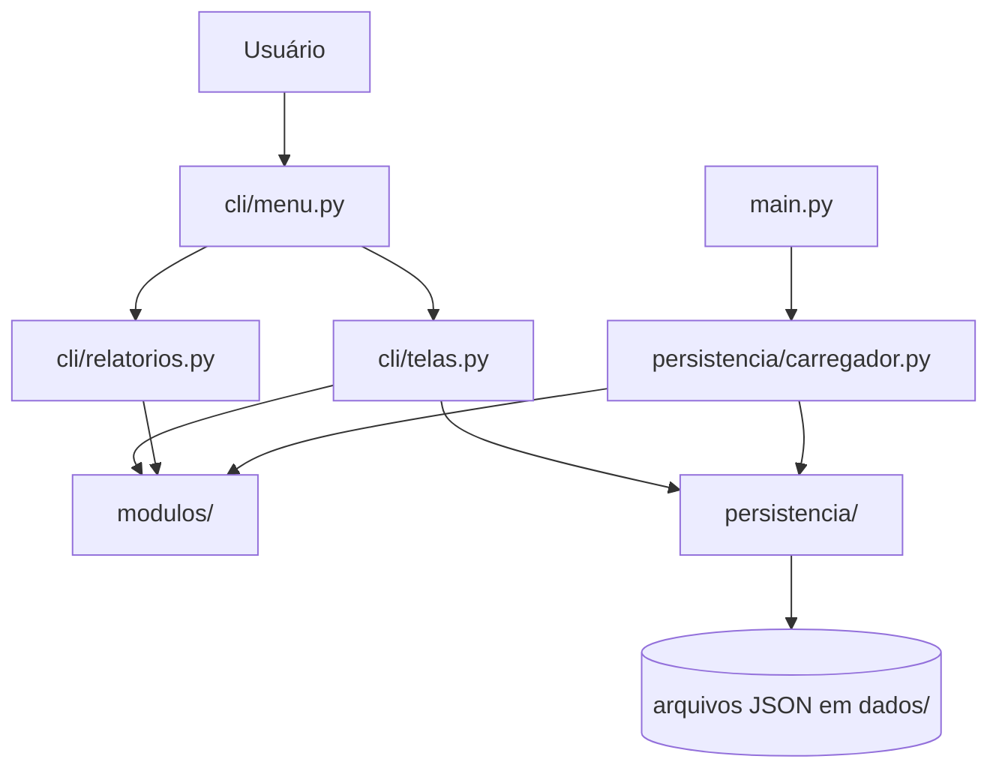

# Gerenciador de Cursos e Alunos

Sistema acadêmico desenvolvido em Python, com interface de linha de comando (CLI), Programação Orientada a Objetos e persistência em arquivos JSON. A aplicação permite administrar cursos, alunos, turmas e matrículas, aplicar regras de matrícula e consultar relatórios acadêmicos.

## Sumário

- [Funcionalidades](#funcionalidades)
- [Regras de negócio e validações](#regras-de-negócio-e-validações)
- [Relatórios](#relatórios)
- [Organização e decisões de design](#organização-e-decisões-de-design)
- [UML](#uml)
- [Estrutura do projeto](#estrutura-do-projeto)
- [Instalação e execução](#instalação-e-execução)
- [Persistência e dados de demonstração](#persistência-e-dados-de-demonstração)
- [Testes](#testes)
- [Limitações conhecidas](#limitações-conhecidas)

## Funcionalidades

### Cursos

- Cadastrar, listar, editar e remover cursos.
- Armazenar código, nome, carga horária, ementa opcional e pré-requisitos.
- Adicionar e remover pré-requisitos.
- Impedir código duplicado, pré-requisito inexistente, autorreferência e ciclos entre pré-requisitos.
- Manter compatibilidade com arquivos JSON antigos que ainda não possuem o campo `ementa`.

### Alunos

- Cadastrar, listar, editar e remover alunos.
- Armazenar matrícula, nome e e-mail.
- Consultar histórico acadêmico e Coeficiente de Rendimento (CR).
- Consultar turmas em que o aluno possui matrícula ativa.

### Turmas

- Criar, listar, abrir, fechar e remover turmas.
- Definir curso, período letivo, dias, horários, capacidade e local.
- Consultar ocupação das vagas.

### Matrículas

- Matricular alunos em turmas abertas.
- Lançar nota e frequência.
- Consultar situação acadêmica.
- Trancar matrícula dentro do prazo configurado.

## Regras de negócio e validações

### Cursos

- O código é normalizado para letras maiúsculas, deve ter pelo menos três caracteres e não pode ser duplicado. A regra atual não exige que o código contenha letras; portanto, um código como `003` é aceito.
- O nome precisa conter pelo menos uma letra. Números podem aparecer junto com letras, por exemplo, `Programação 2`.
- A carga horária deve ser um número inteiro positivo.
- A ementa é opcional. Quando informada, deve ser texto. Na edição, `Enter` mantém a ementa atual e `-` a remove.
- Um curso não pode ser removido quando está vinculado a turmas, consta no histórico dos alunos ou é pré-requisito de outro curso.

### Alunos

- A matrícula não pode ser vazia e deve ser única no cadastro.
- O nome deve conter letras e não pode conter algarismos.
- O e-mail precisa seguir uma estrutura básica de endereço, como `nome@dominio.com`.
- O aluno precisa ter aprovação em todos os pré-requisitos antes de ingressar em uma turma.

### Turmas

- O semestre deve seguir o padrão `AAAA.1` ou `AAAA.2`, como `2026.2`.
- A capacidade deve ser um número inteiro positivo.
- É necessário informar pelo menos um dia e um horário válido.
- A matrícula só pode ser feita em turma aberta e com vaga disponível.
- Um aluno não pode ter duas matrículas para a mesma turma. Essa restrição também se aplica quando a matrícula anterior foi trancada, evitando registros duplicados que seriam rejeitados pelo carregador JSON.
- Um aluno não pode ter conflito de horário com outra turma ativa no mesmo semestre.
- Quando configurado, o limite de turmas simultâneas por aluno é respeitado.

### Matrículas e trancamento

- Nota deve estar entre 0 e 10; frequência, entre 0 e 100.
- Matrículas trancadas não ocupam vagas, não ficam na lista de turmas ativas do aluno e não participam dos relatórios de resultados concluídos.
- Matrículas trancadas permanecem armazenadas para preservar o registro da operação.
- Não é permitido lançar nota ou frequência em uma matrícula trancada.

### Entrada pela CLI

- Os campos de texto, inteiros e números decimais têm até três tentativas de entrada.
- Depois de três valores inválidos, a operação é cancelada e o usuário retorna ao submenu correspondente.
- Uma regra de negócio que falha depois do preenchimento também encerra aquela operação; o sistema não reinicia silenciosamente o cadastro.
- Os submenus permanecem abertos após cada operação para permitir outras ações. A opção `0 - Voltar` retorna ao menu anterior.

## Relatórios

As implementações dos relatórios ficam centralizadas em `cli/relatorios.py`. `cli/telas.py` apenas reexporta os nomes públicos antigos para manter compatibilidade com chamadas existentes; não mantém uma segunda implementação.

| Relatório | Conteúdo e critério |
|---|---|
| Alunos por turma | Lista matrículas ativas, mostra ocupação `vagas ocupadas / capacidade` e informa separadamente os trancamentos. |
| Top N por CR no período | Solicita o período letivo e calcula a média simples das notas concluídas associadas às turmas daquele período. A quantidade exibida usa `top_n_alunos`. |
| Taxa de aprovação | Apresenta resultados agrupados por curso e por turma. Considera matrículas concluídas ativas; trancadas ou ainda cursando não entram no denominador. |
| Distribuição de notas | Apresenta média, mediana e desvio padrão das notas em matrículas ativas por turma. |
| Alunos em risco | Lista matrículas ativas com nota ou frequência abaixo dos limites configurados. |

**CR por período:** são usadas notas do histórico que possuem ID de turma associado. Registros de histórico antigos sem esse vínculo não podem ser atribuídos a um período e, por isso, não entram nesse ranking.

## Organização e decisões de design

O projeto está organizado em quatro áreas principais:

- `modulos/`: entidades do domínio e regras acadêmicas.
- `cli/`: menus, operações de interação e apresentação dos relatórios.
- `persistencia/`: leitura, gravação e reconstrução dos objetos a partir dos arquivos JSON.
- `dados/`: arquivos JSON usados para persistência.

Decisões principais:

- **Encapsulamento:** atributos do domínio são controlados por propriedades que validam os valores antes de armazená-los.
- **Herança múltipla:** `Aluno` herda de `Pessoa` e `HistoricoAcademico`, combinando dados pessoais e operações de histórico/CR.
- **Herança simples:** `Turma` herda de `Oferta`, reutilizando período, capacidade, local e estado de abertura.
- **Catálogo de cursos:** `CatalogoCursos` centraliza unicidade e dependências entre pré-requisitos.
- **Matrícula como associação:** `Matricula` representa a relação entre um aluno e uma turma, com nota, frequência, data e situação.
- **Relatórios separados:** os cálculos e a apresentação dos relatórios ficam em `cli/relatorios.py`, separados das operações de cadastro em `cli/telas.py`.
- **Persistência:** as entidades implementam `to_dict`/`from_dict`; `JsonManager` lê e grava arquivos; `carregador.py` recompõe as referências entre os objetos.

### Fluxo arquitetural



## UML

O diagrama de classes e o diagrama de sequência estão em [`docs/uml.md`](docs/uml.md). O arquivo utiliza Mermaid e pode ser visualizado diretamente pelo GitHub.

## Estrutura do projeto

```text
Gerenciador-de-cursos/
├── cli/
│   ├── menu.py
│   ├── telas.py
│   └── relatorios.py
├── dados/
│   ├── alunos.json
│   ├── cursos.json
│   ├── matriculas.json
│   └── turmas.json
├── docs/
│   └── uml.md
├── modulos/
│   ├── aluno.py
│   ├── catalogo_cursos.py
│   ├── curso.py
│   ├── historico_academico.py
│   ├── matricula.py
│   ├── oferta.py
│   ├── pessoa.py
│   └── turma.py
├── persistencia/
│   ├── carregador.py
│   ├── json_manager.py
│   └── seed.py
├── tests/
│   ├── conftest.py
│   ├── test_aluno.py
│   ├── test_carregador.py
│   ├── test_cli.py
│   ├── test_curso.py
│   ├── test_matricula.py
│   ├── test_relatorios.py
│   ├── test_turma.py
│   └── test_validacoes_regras.py
├── main.py
├── requirements.txt
├── settings.json
├── settings.py
└── README.md
```

## Instalação e execução

### Requisitos

- Python 3.10 ou superior.
- `pip`.

### Instalação

Clone o repositório e entre na pasta:

```bash
git clone https://github.com/ramona-dev/Gerenciador-de-cursos.git
cd Gerenciador-de-cursos
```

Crie e ative um ambiente virtual (recomendado):

```bash
python -m venv .venv
```

Windows PowerShell:

```powershell
.venv\Scripts\Activate.ps1
```

Linux/macOS:

```bash
source .venv/bin/activate
```

Instale as dependências:

```bash
pip install -r requirements.txt
```

Inicie o sistema:

```bash
python main.py
```

## Persistência e dados de demonstração

Os arquivos JSON são armazenados em `dados/`:

- `cursos.json`
- `alunos.json`
- `turmas.json`
- `matriculas.json`

`persistencia/json_manager.py` centraliza leitura e gravação. `persistencia/carregador.py` reconstrói os objetos e valida referências entre cursos, turmas, alunos e matrículas.

Para recriar os dados de demonstração:

```bash
python -m persistencia.seed
```

**Atenção:** a geração do seed sobrescreve os arquivos JSON atuais da pasta `dados/`. Faça uma cópia antes de executar o comando.

As configurações ficam em `settings.json`:

| Chave | Descrição |
|---|---|
| `nota_minima_aprovacao` | Nota mínima para aprovação. |
| `frequencia_minima` | Percentual mínimo de frequência. |
| `data_limite_trancamento` | Último dia permitido para trancamento. |
| `max_turmas_por_aluno` | Quantidade máxima de turmas ativas; `null` não impõe limite. |
| `top_n_alunos` | Quantidade exibida no ranking de CR. |

## Testes

A suíte automatizada utiliza `pytest` e cobre entidades, validações, regras de matrícula, horários, persistência, interface CLI e relatórios. Os testes adicionais de `tests/test_validacoes_regras.py` verificam, entre outros pontos, nomes numéricos, e-mails, ementa, semestre, capacidade, tentativas limitadas de entrada e matrícula após trancamento.

Execute os testes na raiz do projeto:

```bash
python -m pytest -q
```

## Limitações conhecidas

- O CR é calculado como média aritmética simples das notas; não é ponderado pela carga horária.
- Registros antigos de histórico sem ID de turma são preservados, mas não podem ser classificados por período no ranking.
- A validação de e-mail verifica a estrutura básica do endereço; não verifica se a caixa postal ou o domínio realmente existem.

## Responsável

**Ramona Vitória**  
Projeto acadêmico de Engenharia de Software.
