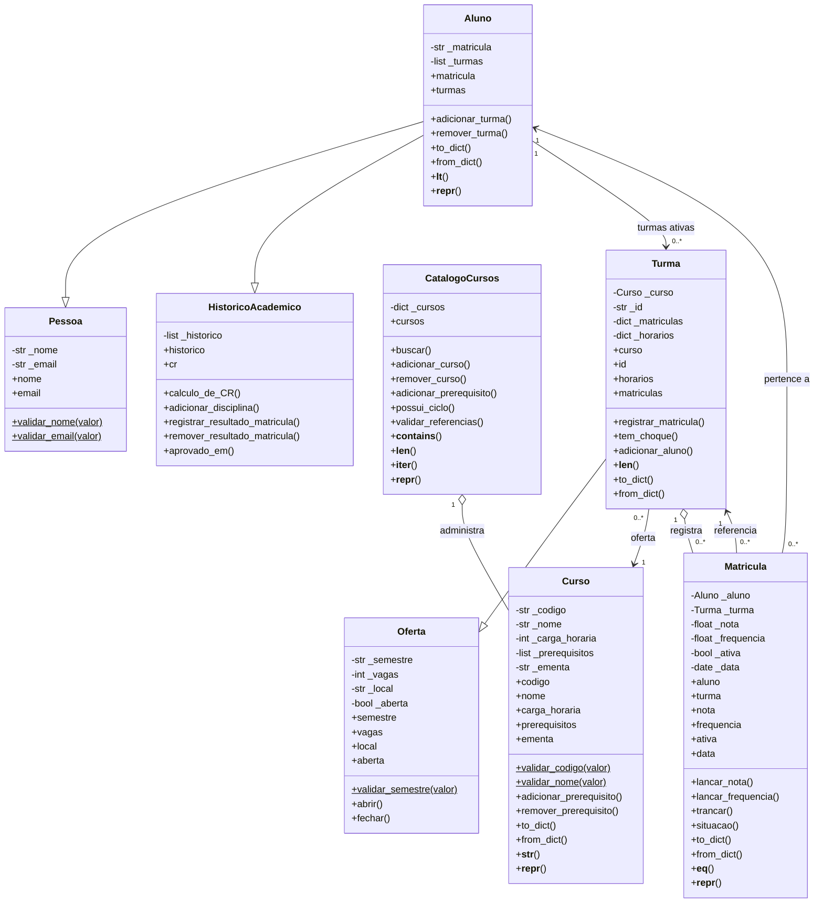
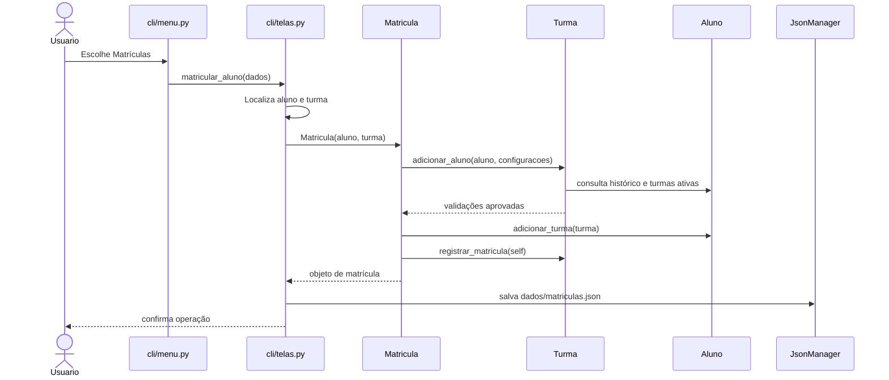

# UML — Gerenciador de Cursos e Alunos

Os diagramas abaixo representam as classes e os fluxos que estão implementados no repositório.

## Diagrama de classes

## Diagrama de sequência — matrícula de aluno

## Interpretação

- **Herança múltipla:** `Aluno` herda de `Pessoa` e `HistoricoAcademico`, reunindo dados pessoais e comportamento de histórico/CR.
- **Herança simples:** `Turma` herda de `Oferta`, reutilizando período, capacidade, local e estado de abertura.
- **Catálogo:** `CatalogoCursos` administra cursos e valida unicidade e dependências entre pré-requisitos.
- **Curso:** mantém código, nome, carga horária, lista de pré-requisitos e ementa opcional.
- **Matrícula:** associa um aluno a uma turma e registra nota, frequência, data e estado.
- **Trancamento:** uma matrícula trancada permanece registrada, mas não ocupa vaga nem permanece na coleção de turmas ativas do aluno. O sistema não permite criar um segundo registro para o mesmo aluno e turma.

## Camadas

| Camada | Responsabilidade |
|---|---|
| `main.py` | Inicializa o carregamento dos dados e o menu. |
| `cli/menu.py` | Navegação entre menu principal e submenus. |
| `cli/telas.py` | Entrada de dados, validações de interface e operações CRUD/matrícula. |
| `cli/relatorios.py` | Cálculos e apresentação dos relatórios. |
| `modulos/` | Entidades e regras de negócio do domínio. |
| `persistencia/` | Leitura, gravação e reconstrução dos objetos. |
| `dados/` | Armazenamento em JSON. |
